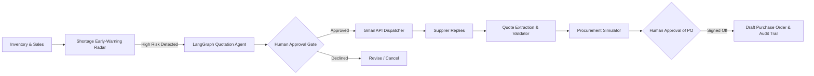

# MediProcure AI — Predict. Protect. Procure.

> **AI-Powered Medicine Procurement Decision-Support System**  
> Initial Focus: Independent Pharmacies in Pakistan | **NYLP AI Hackathon 2026**

[](https://www.python.org/)
[](./PROJECT_AUDIT_MISSING_PARTS.txt)
[](./backend/)
[](./ai_engine/agent/)
[](./ai_engine/gmail/)
[](./LICENSE)

---

## 1. Problem Statement

Pharmacies in Pakistan and developing healthcare markets struggle to balance customer medicine demand with unpredictable supplier lead times, minimum order quantities (MOQ), and fluctuating prices. 

Standard pharmacy inventory software only triggers simple low-stock warnings when an arbitrary threshold is reached. But **a low-stock alert alone does not tell a pharmacist what to do** when:
- Usual distributors are out of stock.
- Delivery lead times exceed remaining stock coverage.
- Multiple suppliers provide conflicting quotes with different pack sizes and MOQs.
- Pharmacists waste hours calling distributors or typing repetitive emails.

**MediProcure AI** bridges the gap between risk detection and procurement execution through an intelligent, human-controlled decision-support loop.

---

## 2. Core Features

1. **Shortage Early-Warning Radar:** Deterministic risk engine evaluating stock coverage days, daily sales velocity, and incoming shipments to project the exact stockout date.
2. **Gmail Supplier Quotation Agent:** AI-assisted agent that drafts standardized quotation inquiries and sends them to registered distributors via Gmail with mandatory human approval.
3. **Structured Quotation Extraction & Validation:** Automated parsing of inbound supplier reply emails into structured schemas (price, MOQ, lead time, delivery charges, validity) with anomaly flags.
4. **Constraint-Aware Procurement Simulator:** Multi-variable simulation comparing **Cheapest**, **Fastest**, and **Split-Order** scenarios, or explaining why options are infeasible.
5. **Interactive What-If Engine:** Dynamic recalculation of procurement scenarios under hypothetical budget changes, demand surges, or supplier delays.
6. **Human-in-the-Loop Approval & Immutable Audit Trail:** Zero autonomous financial commitments; strict human sign-off on outbound emails and draft purchase orders.
7. **Category Demand Forecast Recommendations:** A Random Forest forecasts weekly demand for the bundled dataset categories, then the dashboard matches those categories to medicines whose pharmacy-entered stock or reorder levels need action. The historical category dataset is not presented as local pharmacy sales, and a pharmacist enters and reviews RFQ quantities.

---

## 3. Architecture & Workflow

MediProcure AI decouples deterministic business rules from generative AI orchestration:



- **Calculations & Constraints:** Pure deterministic Python logic (never hallucinated).
- **AI Agent:** LangGraph state graph with `interrupt()` for human approvals.
- **Security:** Inbound email text is treated as untrusted input. OAuth secrets remain strictly on the backend.

---

## 4. Documentation Index

Comprehensive technical documentation is maintained in the [`docs/`](./docs/) directory:

- 📐 **[System Architecture](./docs/ARCHITECTURE.md):** Architectural blueprints, component interactions, security, and state management.
- 📋 **[Feature Specifications](./docs/FEATURES_SPEC.md):** Deep-dive requirements, mathematical models, inputs/outputs, and UI specifications for all 9 features.
- 🗺️ **[Phases & Roadmap](./docs/PHASES_AND_ROADMAP.md):** Phase-by-phase implementation status, task checklists, and workstream deliverables.
- 🔌 **[API & Data Models](./docs/API_AND_DATA_MODELS.md):** REST endpoints, Pydantic validation schemas, and database ER models.
- 🧪 **[Evaluation & Testing Suite](./docs/EVALUATION_AND_TESTING.md):** 12 controlled evaluation scenarios, baseline comparison, and test metrics.
- ⚖️ **[Hackathon Compliance & Team Charter](./docs/HACKATHON_COMPLIANCE.md):** NYLP AI Hackathon 2026 rules alignment, AI methodology disclosure, and team workstreams.
- 📝 **[Changelog & Milestone Notes](./docs/CHANGELOG.md):** Chronological implementation progress and audit records.

---

## 5. Workspace Skills & Collaborative Setup

- **Installed Skills (`skills/` & `.agents/skills/`):**
  - **[`mediprocure-agent`](./skills/mediprocure-agent/SKILL.md):** Operational runbook for developing, running, and testing MediProcure AI's shortage risk, quotation agent, and PO flows.
  - **[`find-skills`](./skills/find-skills/SKILL.md):** Vercel Labs open skills ecosystem search and discovery utility.
  - **[`ponytail`](./skills/ponytail/SKILL.md):** Minimalist senior dev discipline, YAGNI enforcement, and anti-overengineering rules.
  - **[`graphify`](./skills/graphify/SKILL.md):** Knowledge graph generator, AST code relationship mapping, and structural understanding.
  - **[`fastapi`](./skills/fastapi/SKILL.md):** Official FastAPI best practices, Pydantic v2 schemas, dependencies, routing, and SSE streaming.
  - **[`supabase-postgres-best-practices`](./skills/supabase-postgres-best-practices/SKILL.md):** PostgreSQL relational database modeling, indexing, and query patterns.
  - **[`web-design-guidelines`](./skills/web-design-guidelines/SKILL.md):** Web interface guidelines, accessibility, modern styling, and UX standards.
- **Rules:** [`.agents/rules/coding-standards.md`](./.agents/rules/coding-standards.md) — Development guardrails and safety standards.
- **Directives:** [`AGENTS.md`](./AGENTS.md) — Workspace-level directives for human developers and AI pair programmers.
- **Manifest:** [`skills-lock.json`](./skills-lock.json) — Version lockfile tracking skill sources, hashes, and upstream repositories.

---

## 6. Quickstart Guide

### 6.1 Clone & Setup Environment
```powershell
# Clone the repository
git clone https://github.com/ahadxdev/MediCure_AI.git
cd MediCure_AI

# Create and activate virtual environment
python -m venv .venv
.\.venv\Scripts\Activate.ps1

# Install core and backend dependencies
pip install -r ai_engine/requirements-ml.txt
pip install -r backend/requirements.txt
```

### 6.2 Run Automated Unit Tests (100% Passing)
```powershell
# Run the complete test suite (24 tests across risk engine, parser, and FastAPI backend)
pytest
```

### 6.3 Run the FastAPI Backend Server
```powershell
# Start FastAPI development server with auto-reload
uvicorn backend.main:app --reload --port 8000
```
- Interactive Swagger UI: `http://localhost:8000/docs`
- Health check: `http://localhost:8000/api/system/health`
- Inventory & Shortage Radar: `http://localhost:8000/api/inventory`
- Shortage Risk Calculator: `POST http://localhost:8000/api/risk/evaluate`

### 6.4 Run the AI Agent Interactive Demo
```powershell
python run_agent_demo.py
```
*Demonstrates shortage detection, quotation request generation, LangGraph human approval prompt (`yes/no`), and email dispatching.*

### 6.5 Test Gmail API Gateway
```powershell
# Test OAuth authentication loading
python test_gmail_connection.py

# Test controlled single-email send (requires explicit confirmation)
python test_gmail_send.py
```

---

## 7. Current Project Status

- **Phase 1 (AI Engine & Risk Module):** Completed & Verified (16/16 unit tests passing).
- **Phase 2 (FastAPI Backend & Relational DB):** Milestone 1 Complete. Models, database connectivity, inventory endpoint, shortage-risk evaluation endpoint, seed data loader, and 8 API unit tests passing (24/24 tests total).
- **Phase 3 (Procurement Simulator):** Algorithm and mathematical specifications completed; ready for implementation.
- **Phase 4 (Web Frontend):** Wireframes and component interfaces documented.
- **Phase 5 (Hackathon Submission):** Full compliance checklist verified.
- **Audit status (2026-10-19):** Frontend build and Python compilation pass. The
  backend regression suite has 106 passing tests; see
  [`PROJECT_AUDIT_MISSING_PARTS.txt`](./PROJECT_AUDIT_MISSING_PARTS.txt).

---

## 8. Team & Attribution

Developed for **NYLP AI Hackathon 2026** (Deadline: 19 October 2026, 11:59 PM PKT).
- **Workstream 1:** AI & Agent Workflow
- **Workstream 2:** Backend & Data Engineering
- **Workstream 3:** Frontend & Integration
