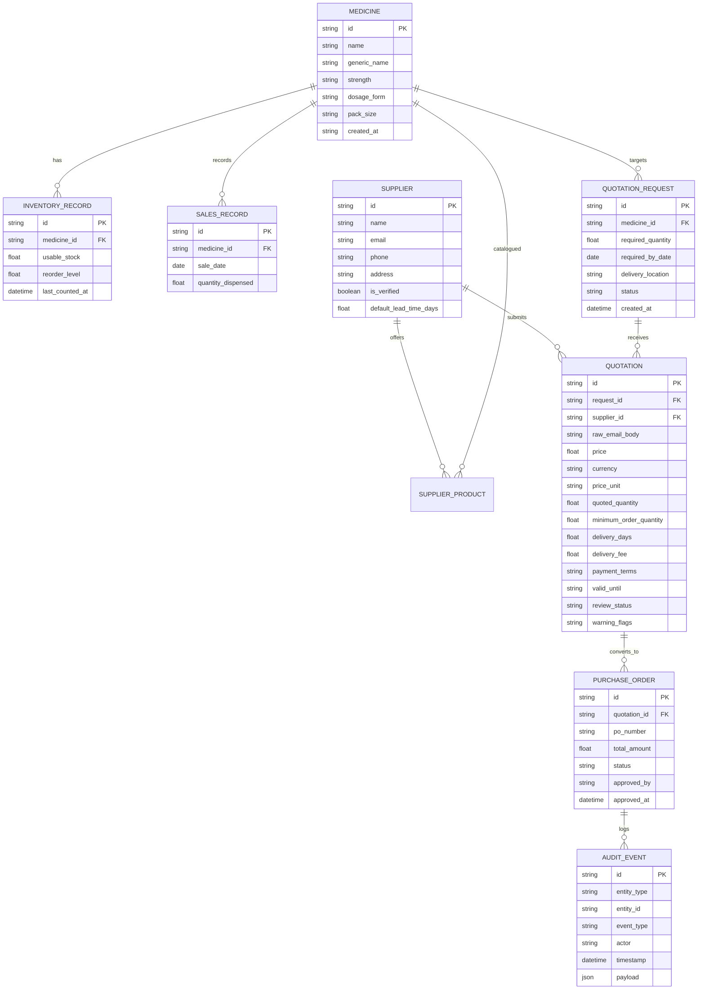

# MediProcure AI — API Specifications & Data Models

> **Protocol:** RESTful JSON over HTTP  
> **Backend Framework:** FastAPI  
> **Data Validation:** Pydantic v2  
> **Database:** PostgreSQL (with SQLite local fallback)

---

## 1. Entity-Relationship Data Model



---

## 2. Pydantic Schemas

### 2.1 Shortage Risk Assessment
```python
from pydantic import BaseModel, Field

class IncomingShipment(BaseModel):
    quantity: float = Field(gt=0)
    days_until_arrival: float = Field(ge=0)

class RiskAssessmentRequest(BaseModel):
    usable_stock: float = Field(ge=0)
    avg_daily_demand: float = Field(ge=0)
    supplier_lead_time_days: float | None = Field(default=None, ge=0)
    incoming_shipments: list[IncomingShipment] = Field(default_factory=list)

class RiskAssessmentResponse(BaseModel):
    status: str
    coverage_days: float | None
    stockout_days_without_incoming: float | None
    estimated_stockout_days: float | None
    stock_at_delivery: float | None
    stockout_before_delivery: bool | None
    first_stockout_day: float | None
    risk_flags: list[str]
    assumptions: list[str]
```

### 2.2 Quotation Request & Email Draft
```python
class EmailDraft(BaseModel):
    to: list[str]
    subject: str
    body: str

class QuotationDraftRequest(BaseModel):
    medicine_id: str
    required_quantity: float = Field(gt=0)
    delivery_location: str
    required_by_date: str
    supplier_ids: list[str]

class QuotationApprovalAction(BaseModel):
    thread_id: str
    approved: bool
    notes: str | None = None
```

### 2.3 Procurement Simulation Models
```python
class ScenarioOption(BaseModel):
    scenario_type: str  # "cheapest", "fastest", "split_order", "infeasible"
    supplier_name: str | None
    allocated_quantity: float
    unit_price: float | None
    delivery_fee: float | None
    total_cost: float | None
    delivery_days: float | None
    residual_shortage_days: float
    explanation: str

class SimulationResult(BaseModel):
    medicine_name: str
    options: list[ScenarioOption]
    data_quality_flags: list[str]
```

---

## 3. Core REST Endpoints

### 3.1 Inventory & Shortage Radar
- `GET /api/inventory`: Returns current stock, reorder levels, and 30-day demand velocity for all catalog medicines.
- `POST /api/inventory`: Creates a medicine and its initial inventory record.
- `GET /api/inventory/{medicine_id}`: Retrieves one medicine and its calculated inventory status.
- `PUT /api/inventory/{medicine_id}`: Updates medicine details, usable stock, and reorder level.
- `DELETE /api/inventory/{medicine_id}`: Deletes a medicine only when no sales or quotation history references it.
- `GET /api/suppliers`: Lists suppliers; `GET /api/suppliers/{supplier_id}` retrieves one supplier.
- `POST /api/suppliers`: Creates a supplier; `PUT /api/suppliers/{supplier_id}` updates one.
- `DELETE /api/suppliers/{supplier_id}`: Deletes a supplier only when no quotation history references it.
- `POST /api/risk/evaluate`: Computes deterministic shortage risk for a specific medicine record.
- The API does not seed demo records on startup or inventory reads. Add medicines and suppliers through the CRUD endpoints.

### 3.2 Quotations & Supplier Messaging
- `POST /api/quotes/requests`: Creates an RFQ draft; it does not send email.
- `GET /api/quotes/requests/{request_id}/draft`: Generates the LangGraph supplier email draft for human review.
- `POST /api/quotes/requests/{request_id}/approve-and-send`: Resumes the approval-gated agent; SIMULATED mode records a simulated dispatch, while LIVE mode sends individual Gmail messages only after explicit approval.
- `POST /api/quotes/inbox/sync`: Reads Gmail replies only in LIVE mode; parses and validates each message and matches it by RFQ reference in the subject. Unmatched or ambiguous messages are ignored.
- `POST /api/quotes/parse`: Parses and validates pasted supplier quotation text.

Gmail defaults to `SIMULATED`. To enable real access, configure `GMAIL_MODE=LIVE` and provide valid OAuth `credentials.json` and `token.json` files on the backend only. Live sending and inbox access were not verified against an external Gmail account; test with a controlled account and explicit approval.

### 3.3 Procurement Simulation & Purchase Orders
- `POST /api/procurement/simulate`: Runs multi-criteria comparison across verified quotes.
- Simulation accepts a medicine ID and evaluates only validated quotes for that medicine that meet quantity, MOQ, budget, and delivery constraints.
- `POST /api/procurement/what-if`: Runs dynamic constraint recalculations with user-specified budget/demand overrides.
- `POST /api/orders/create-draft`: Generates formal Draft Purchase Order based on selected simulation option.
- `POST /api/orders/{id}/approve`: Final human sign-off committing the PO and logging audit record.

### 3.4 Auditing & System Status
- `GET /api/audit/logs`: Fetches chronological audit trail with pagination and entity filtering.
- `GET /api/system/health`: Reports health status of FastAPI server, DB connection, and Gmail OAuth status.
