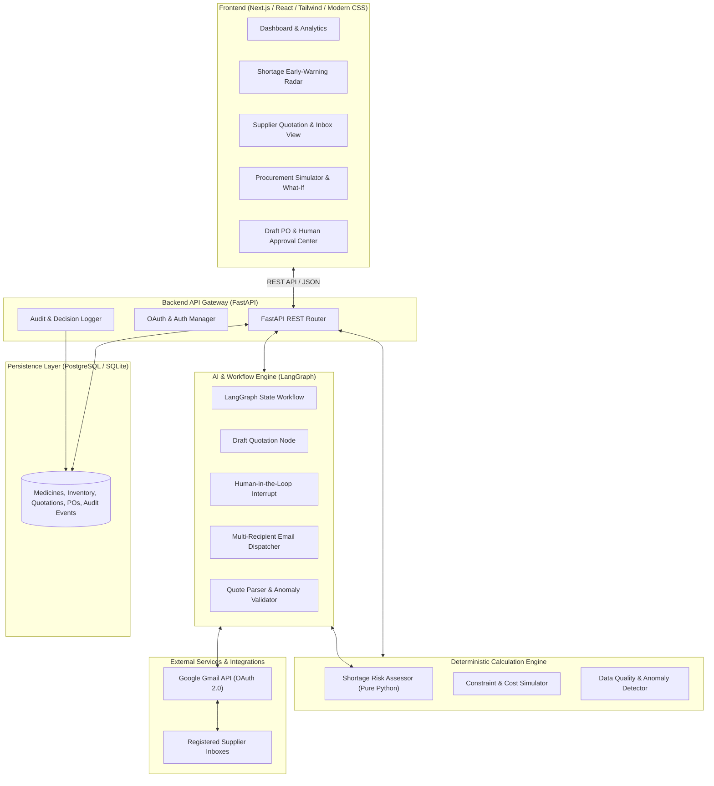
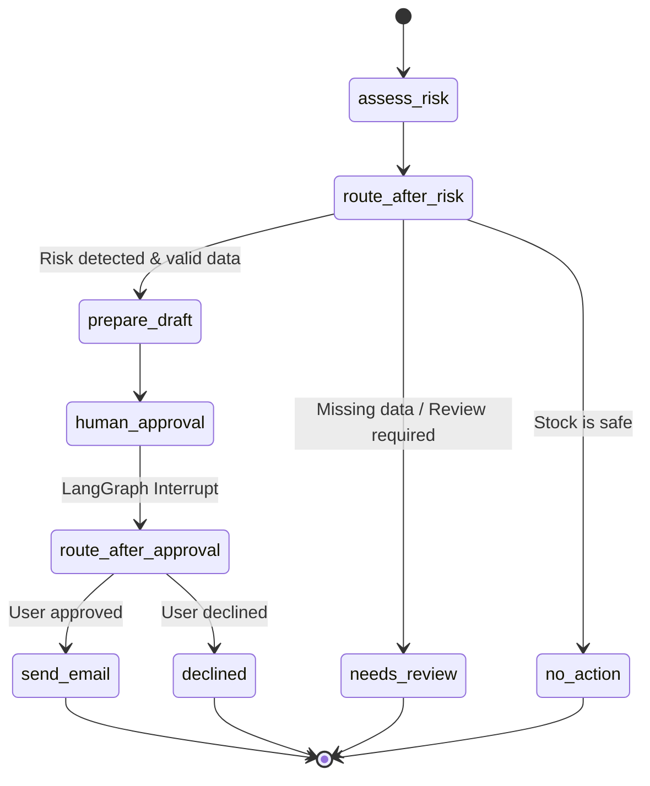

# MediProcure AI — System Architecture Specification

> **System Type:** AI-Powered Medicine Procurement Decision-Support System  
> **Target Market:** Independent Pharmacies in Pakistan  
> **Hackathon:** NYLP AI Hackathon 2026  
> **Status:** Phase 1 Complete (AI Engine & Risk Module), Phase 2-5 Architecture Defined

---

## 1. Executive Summary

MediProcure AI solves the critical challenge independent pharmacies face: managing inventory when suppliers, delivery lead times, minimum order quantities (MOQ), and pricing are unpredictable. A low-stock alert alone does not tell a pharmacist what to do when cost, delivery timing, quantity constraints, and supplier reliability conflict.

MediProcure AI integrates:
1. **Deterministic Shortage Risk Analysis** (coverage, lead times, stockout timing, incoming shipments).
2. **Gmail-based Supplier Quotation Automation** (drafting, human approval gate, sending, receiving, parsing).
3. **Structured Quotation Extraction & Validation** (rule-based and LLM extraction with strict anomaly flags).
4. **Constraint-Aware Procurement Scenario Simulation** (evaluating cheapest, fastest, split-order, and unfeasible scenarios).
5. **Human-in-the-Loop Approval & Immutable Audit Trail** (zero autonomous financial commitments).

---

## 2. Architectural Blueprint

The architecture is strictly decoupled into three layers:
- **Presentation Layer (Frontend):** Next.js / React single-page application with modern UI, dark mode, glassmorphic data cards, shortage radar visualizer, and approval workflows.
- **Application & Orchestration Layer (Backend):** FastAPI REST API paired with a LangGraph stateful agent orchestrator that enforces human-in-the-loop interrupts.
- **Deterministic Engine & Storage Layer:** Pure mathematical evaluation services (risk calculation, scenario optimizer), Gmail OAuth 2.0 gateway, and relational database (PostgreSQL with SQLAlchemy/Pydantic schemas).

---

## 3. Component Details & Boundaries

### 3.1 Shortage Early-Warning Radar (`ai_engine/risk/shortage_risk.py`)
- **Responsibility:** Deterministically calculates days of stock coverage, estimated stockout day, and stock at expected delivery.
- **Guardrails:**
  - Zero-demand input never produces misleading infinite coverage; it triggers `review_required`.
  - Negative values for stock, demand, or lead times are rejected with validation errors.
  - Incoming shipments arriving after stockout are accounted for transparently without hiding the intervening stockout gap.
  - Assumptions are explicitly exported with every risk evaluation.

### 3.2 Gmail Quotation Agent (`ai_engine/agent/graph.py` & `ai_engine/gmail/client.py`)
- **Framework:** LangGraph `StateGraph` compiled with `InMemorySaver` / persistent checkpointer.
- **State Transition Flow:**

- **Human-in-the-Loop Interrupt:**
  - The graph halts at node `human_approval` using `langgraph.types.interrupt`.
  - The UI displays the drafted subject, recipients, and message body.
  - Execution resumes only upon receiving explicit user input via `resume_agent(graph, approved=True, config=...)`.
  - **Defense-in-depth:** Node `send_email_real` independently verifies `decision.get("approved") is True` before invoking Gmail API.

### 3.3 Quotation Extraction & Validation (`ai_engine/quotes/`)
- **Parser (`parser.py`):** Extracts medicine name, strength, dosage form, pack size, price, currency, quantity, MOQ, delivery days, delivery fees, payment terms, and validity date.
- **Validator (`validator.py`):** Flags missing mandatory fields, unstated validity, zero or negative prices, and cases where quoted quantity is below MOQ. Mark review status as `needs_review` or `validated`.
- **Security:** Inbound email text is treated as untrusted data. It is never executed as commands or system prompts.

### 3.4 Procurement Response Simulator (`backend/services/procurement.py`)
- Evaluates eligible quotations against:
  1. Lowest Total Cost (Price $\times$ Normalized Quantity + Delivery Fee + Taxes).
  2. Fastest Lead Time (Minimizing residual stockout days).
  3. Split-Order Strategy (Combining offers if single supplier cannot satisfy quantity or MOQ).
  4. Constraint Infeasibility (Clear explanation if budget or MOQ prevents procurement).
- Deterministic formulas guarantee transparent, reproducible rankings.

### 3.5 Database & Entity Model
- Normalized relational schema ensures calculations use strongly typed fields (`float`, `int`, `datetime`) rather than unvalidated unstructured JSON blobs.
- Full details documented in `docs/API_AND_DATA_MODELS.md`.

---

## 4. Security & Safety Architecture

1. **OAuth 2.0 Credential Isolation:**
   - Client secrets (`credentials.json`) and access/refresh tokens (`token.json`) are stored strictly server-side.
   - Files are added to `.gitignore`. No tokens are passed to frontend clients or logged.
2. **Untrusted Input Sanitation:**
   - Inbound supplier emails cannot override agent system prompts.
   - Regex and structural extractors isolate fields without executing raw code.
3. **Simulated Mode vs. Live Mode:**
   - If Gmail API credentials are not configured, the system operates in a simulated sandbox.
   - All simulated operations are explicitly tagged with `is_simulated = True` in API responses and UI badges.
4. **Audit Immutability:**
   - Every human approval, modification, or rejection is recorded with user ID, timestamp, and prior/new state values.
